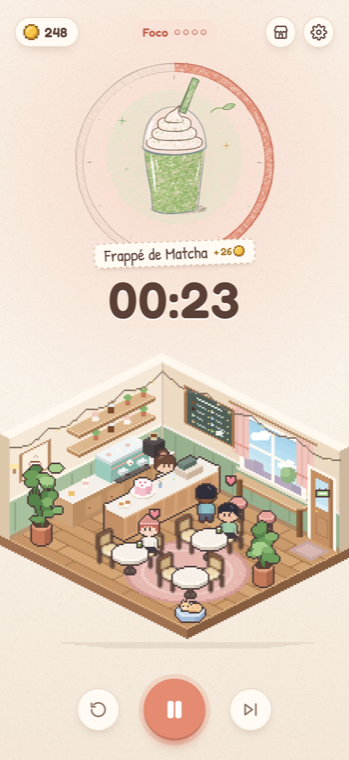
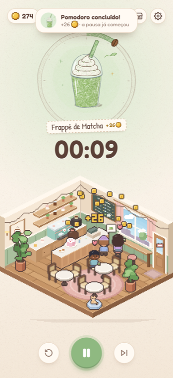
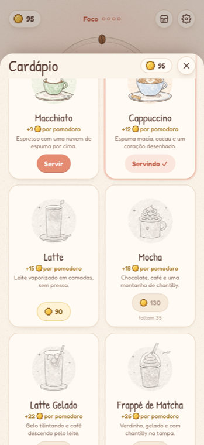

# ☕ Café Pomo

A cozy pomodoro game for the iPhone (designed at the 6.9" size, 440 × 956 pt). While you focus, a
little Habbo-style pixel-art cafe opens: customers walk in, queue up, the barista brews the drink you
chose and they sit down to enjoy it. Each finished pomodoro pays coins, and coins unlock new drinks,
each one drawn in colored pencil.

<p>
  
  
  
</p>

The interface is in Brazilian Portuguese.

**Play it at <https://carolinewk.github.io/cafe-pomo/>.** On the iPhone, open it in Safari and tap
**Share → Add to Home Screen**.

## Run locally

Requires Node.js 22 or newer. There are no dependencies to install.

```sh
npm run dev
```

Open **http://localhost:4180**. On a desktop browser the app is shown inside an iPhone frame.

### On the iPhone

1. Run `npm run dev` on the Mac. The terminal also prints a LAN address, such as `http://192.168.0.8:4180`.
2. Open that address in Safari on the iPhone, on the same Wi-Fi.
3. Tap **Share → Add to Home Screen**. Café Pomo then opens full screen, without Safari's bars, at the
   size it was designed for.

### Deploy

Every push to `main` runs the tests and publishes the `www/` folder to GitHub Pages
(`.github/workflows/pages.yml`). Any other static host works too: publish `www/`. On HTTPS the service
worker caches the app, so it also works offline.

## How it plays

- **Timer:** 25 min focus, 5 min break, and a 15 min long break after every 4 focus sessions. All
  lengths can be changed in **Ajustes**. Breaks start on their own by default.
- **Coins:** a finished focus session pays the rate of the drink being served. The Espresso pays
  **5 coins**, scaled to the session length (a 50 min session pays double). Skipping or restarting a
  focus session pays nothing. If the app was closed while the timer ran, it catches up when you come
  back.
- **Menu (Cardápio):** tap the coins, the drink or the shop button. Locked drinks are uncolored
  graphite sketches. They fill with color once bought, and the new drink is served right away.

| Drink | Price | Coins per pomodoro |
| --- | ---: | ---: |
| Espresso | — | 5 |
| Espresso Duplo | 15 | 7 |
| Macchiato | 35 | 9 |
| Cappuccino | 60 | 12 |
| Latte | 90 | 15 |
| Mocha | 130 | 18 |
| Latte Gelado | 180 | 22 |
| Frappé de Matcha | 240 | 26 |
| Frappé de Caramelo | 310 | 30 |
| Affogato | 390 | 35 |
| Latte de Lavanda | 480 | 40 |
| Matcha de Morango | 600 | 46 |

Buying each drink in order takes 107 pomodoros, about 45 hours of focus.

### The cafe

- **Focus:** the cafe is open. Customers carry the drink you serve, in its colors, and you can see the
  order bubbles and the hearts.
- **Breaks:** the sign on the door turns pink, the last customers leave, the barista sits down with
  her own coffee and the cat wakes up.
- **Window:** the sky follows the real time of day: morning, day, sunset and a starry night.
- **Chalkboard:** each drink you unlock adds a colored line to the menu. A longer menu brings more
  customers.

## Development

```sh
npm test            # timer and economy tests (node --test)
```

- `http://localhost:4180/?speed=60` runs the timer 60× faster (a 25 min session takes 25 seconds) and
  is handy for trying the rewards. `?nosw` skips the service worker.
- `www/dev/` holds pages for working on the art. Open each one through the dev server.
  - `art.html`: every illustration. Add `?mono` for the locked versions.
  - `room.html`: the room. Add `?hour=21` for night.
  - `chars.html`: the character sprite sheet.
  - `scene.html`: the living cafe on its own.
  - `icon.html`: the app icon.
  - `seed.html`: writes a save and opens the app, e.g. `seed.html?coins=200&owned=espresso,doppio`.

### How the art is made

Everything is drawn in code at runtime. There are no image files apart from the app icons.

- **Colored pencil (`www/js/art/`):** `pencil.js` is a small brush engine. Lines are tapered, wobbly
  ribbons drawn in two slightly offset passes. Fills are hatched strokes clipped to each shape, with
  ends that land unevenly. Every layer is then masked by a paper-tooth texture, so pigment skips the
  paper's valleys. `coffees.js` composes the 12 drinks out of cups, glasses, cream and drizzles.
- **Pixel art (`www/js/world/`):** `iso.js` is a 2:1 isometric rasterizer (32 × 16 tiles, clean
  two-pixel stair steps) with depth sorting. `room.js` builds the room and furniture. `chars.js`
  holds hand-drawn text sprites with palette swaps: 6 hairstyles, plus walking and sitting poses.
  `scene.js` runs customers, the barista and the cat, with A* pathfinding.

### Layout

- `www/index.html`, `www/style.css`: the app shell.
- `www/js/main.js`: wires the timer, the economy, the cafe and the interface together.
- `www/js/timer.js`: the pomodoro state machine. Pure functions, so it can be saved and catch up.
- `www/js/store.js`, `www/js/catalog.js`: saved progress, coins and the menu.
- `www/js/ui/`: the pencil timer ring, the menu, settings and dialogs.
- `www/js/audio.js`: chimes synthesized with Web Audio.
- `www/sw.js`, `www/manifest.webmanifest`: offline support and home-screen install.
- `scripts/serve.mjs`: the dependency-free dev server.

## Notes

- iOS pauses web apps in the background, so the end-of-session chime only plays while Café Pomo is
  open. The timer keeps counting either way. With **Manter a tela acesa** on (the default), the screen
  stays on during a session.
- Progress is saved in the browser (`localStorage`). Safari treats the home-screen app and the browser
  tab as separate places, so each has its own progress.
- Fonts: [Fredoka](https://fonts.google.com/specimen/Fredoka) and
  [Patrick Hand](https://fonts.google.com/specimen/Patrick+Hand), both under the SIL Open Font License.
